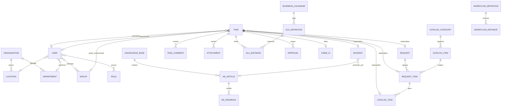

# Modelo de Dados Completo & Especificação de APIs (MVP)

Este documento detalha o banco de dados PostgreSQL (gerenciado via Prisma ORM) e a API REST + WebSocket para a **Fase F1 (Design e Arquitetura)** do MVP single-tenant.

---

## 1. Visão Geral e Convenções de Banco

- **SGBD:** PostgreSQL 16+ com extensões `uuid-ossp` e `pg_trgm` (busca tolerante a erros).
- **Chaves Primárias:** `UUID v4` (`id`) em todas as tabelas, além de um campo legível `number` (ex.: `INC0000001`, `REQ0000001`, `RITM0000001`, `SCTASK0000001`, `KB0000001`) gerado por *sequences* do PostgreSQL.
- **Padrão de Herança (`TASK`):** Incidentes, Requisições, Itens de Requisição e Tarefas compartilham a tabela `tasks` e possuem tabelas de extensão (`incidents`, `requests`, `request_items`, `catalog_tasks`) ligadas por `task_id` (1:1).
- **Timestamps e Soft Delete:** `created_at`, `updated_at` em todas as tabelas; `deleted_at` onde aplicável.
- **No-Code:** Campos personalizados definidos pelo administrador são armazenados na coluna `custom_fields` (`JSONB`) nas entidades extensíveis (`tasks`, `cmdb_cis`), com validação dinâmica via Zod no backend.

---

## 2. Diagrama Entidade-Relacionamento (MVP)

---

## 3. Dicionário de Tabelas (PostgreSQL / Prisma)

### 3.1 Plataforma Base, Organização, Auth & Auditoria (E01, E27)

#### `organization_settings` (Setup único da empresa — US-001)
| Coluna | Tipo | Restrições | Descrição |
|---|---|---|---|
| `id` | `uuid` | PK | Identificador único |
| `company_name` | `varchar(150)` | NOT NULL | Nome da empresa |
| `logo_url` | `text` | NULL | Logo exibido no Portal/Workspace |
| `primary_color` | `varchar(7)` | DEFAULT `'#0F4C81'` | Cor primária da marca |
| `support_email` | `varchar(255)` | NOT NULL | E-mail padrão de atendimento |
| `default_timezone` | `varchar(64)` | DEFAULT `'America/Sao_Paulo'` | Fuso horário padrão |
| `default_locale` | `varchar(10)` | DEFAULT `'pt-BR'` | Idioma padrão (`pt-BR`, `en`, `es`) |
| `auto_close_days` | `integer` | DEFAULT `7` | Dias para fechar incidente resolvido (US-027) |
| `reopen_window_days` | `integer` | DEFAULT `7` | Prazo para usuário reabrir incidente (US-026) |
| `sso_config` | `jsonb` | NULL | Configuração SAML/OIDC (US-003) |

#### `locations` e `departments` (US-332)
- `locations`: `id (uuid PK)`, `name (varchar)`, `country`, `state`, `city`, `timezone`, `is_active (bool)`.
- `departments`: `id (uuid PK)`, `name (varchar)`, `code (varchar)`, `manager_id (uuid FK -> users)`, `is_active (bool)`.

#### `users` (US-002, US-004)
| Coluna | Tipo | Restrições | Descrição |
|---|---|---|---|
| `id` | `uuid` | PK | ID do usuário |
| `email` | `varchar(255)` | UNIQUE NOT NULL | E-mail corporativo (login) |
| `name` | `varchar(150)` | NOT NULL | Nome completo |
| `password_hash` | `text` | NULL | Hash Argon2id (nulo se apenas SSO) |
| `mfa_enabled` | `boolean` | DEFAULT `false` | MFA ativo (TOTP) |
| `mfa_secret_enc` | `text` | NULL | Segredo TOTP criptografado |
| `locale` | `varchar(10)` | DEFAULT `'pt-BR'` | Idioma preferido (US-008) |
| `phone` | `varchar(30)` | NULL | Telefone |
| `job_title` | `varchar(100)` | NULL | Cargo |
| `department_id` | `uuid` | FK -> `departments.id` | Departamento |
| `location_id` | `uuid` | FK -> `locations.id` | Localidade |
| `manager_id` | `uuid` | FK -> `users.id` | Gestor direto (usado em aprovações) |
| `external_id` | `varchar(255)` | NULL, INDEX | ID externo (SCIM / Azure AD) |
| `is_active` | `boolean` | DEFAULT `true` | Usuário ativo |
| `created_at` / `updated_at` | `timestamptz` | NOT NULL | Auditoria |

#### `roles`, `permissions`, `role_permissions`, `user_roles` (US-005)
- `roles`: `id (uuid PK)`, `code (varchar UNIQUE)` (`end_user`, `agent`, `manager`, `admin`), `name`, `description`, `is_system (bool)`.
- `permissions`: `id (uuid PK)`, `module (varchar)`, `action (varchar)` (ex.: `incident.create`, `incident.view_internal`, `admin.nocode`).
- `role_permissions`: `role_id`, `permission_id` (PK composta).
- `user_roles`: `user_id`, `role_id` (PK composta).

#### `groups` e `group_members` (US-331)
- `groups`: `id (uuid PK)`, `name (varchar UNIQUE)`, `description`, `email (varchar)`, `manager_id (uuid FK -> users)`, `is_active (bool)`.
- `group_members`: `group_id`, `user_id` (PK composta).

#### `audit_logs` (US-006 — Imutável, apenas `INSERT`)
| Coluna | Tipo | Restrições | Descrição |
|---|---|---|---|
| `id` | `bigserial` | PK | Sequencial imutável |
| `entity_type` | `varchar(60)` | NOT NULL, INDEX | Ex.: `task`, `incident`, `user`, `sla` |
| `entity_id` | `uuid` | NOT NULL, INDEX | ID do registro alterado |
| `action` | `varchar(30)` | NOT NULL | `CREATE`, `UPDATE`, `DELETE`, `LOGIN` |
| `actor_id` | `uuid` | FK -> `users.id` NULL | Quem executou (nulo se sistema) |
| `field_name` | `varchar(100)` | NULL | Campo alterado |
| `old_value` | `jsonb` | NULL | Valor anterior |
| `new_value` | `jsonb` | NULL | Novo valor |
| `ip_address` | `inet` | NULL | IP de origem |
| `created_at` | `timestamptz` | DEFAULT `now()` | Timestamp exato |

---

### 3.2 Núcleo `TASK` & Gestão de Incidentes (E02, E03)

#### `tasks` (Tabela base unificada)
| Coluna | Tipo | Restrições | Descrição |
|---|---|---|---|
| `id` | `uuid` | PK | Identificador |
| `number` | `varchar(20)` | UNIQUE NOT NULL | Ex.: `INC0000042` |
| `task_type` | `enum` | NOT NULL | `INCIDENT`, `REQUEST`, `REQUEST_ITEM`, `CATALOG_TASK` |
| `short_description` | `varchar(255)` | NOT NULL | Título resumido |
| `description` | `text` | NULL | Descrição detalhada |
| `state` | `varchar(40)` | NOT NULL, INDEX | Estado atual no ciclo de vida |
| `impact` | `smallint` | DEFAULT `3` | 1 (Alto), 2 (Médio), 3 (Baixo) |
| `urgency` | `smallint` | DEFAULT `3` | 1 (Alta), 2 (Média), 3 (Baixa) |
| `priority` | `smallint` | NOT NULL, INDEX | 1 (Crítica) a 5 (Planejada) |
| `priority_override_reason` | `text` | NULL | Motivo caso prioridade seja sobrescrita |
| `requester_id` | `uuid` | FK -> `users.id`, INDEX | Solicitante |
| `opened_by_id` | `uuid` | FK -> `users.id` | Quem abriu |
| `assigned_group_id` | `uuid` | FK -> `groups.id`, INDEX | Grupo responsável |
| `assigned_to_id` | `uuid` | FK -> `users.id`, INDEX | Agente responsável |
| `ci_id` | `uuid` | FK -> `cmdb_cis.id`, NULL | Item de configuração afetado |
| `location_id` | `uuid` | FK -> `locations.id`, NULL | Localidade |
| `custom_fields` | `jsonb` | DEFAULT `'{}'` | Campos criados via No-Code (US-333) |
| `opened_at` | `timestamptz` | DEFAULT `now()` | Abertura |
| `resolved_at` | `timestamptz` | NULL | Resolução |
| `closed_at` | `timestamptz` | NULL | Fechamento |
| `due_at` | `timestamptz` | NULL | Vencimento SLA principal |
| `search_vector` | `tsvector` | GENERATED / GIN | Busca full-text (US-051) |

#### `incidents` (Extensão 1:1 de `tasks` — US-020 a US-033)
| Coluna | Tipo | Restrições | Descrição |
|---|---|---|---|
| `task_id` | `uuid` | PK, FK -> `tasks.id` | Vínculo 1:1 |
| `category_id` | `uuid` | FK -> `categories.id` | Categoria (US-330) |
| `subcategory_id` | `uuid` | FK -> `categories.id` | Subcategoria |
| `channel` | `enum` | NOT NULL | `PORTAL`, `EMAIL`, `PHONE`, `WALK_IN`, `API` |
| `hold_reason_id` | `uuid` | FK -> `hold_reasons.id` | Motivo de espera (quando `ON_HOLD`) |
| `parent_incident_id` | `uuid` | FK -> `incidents.task_id` | Incidente Pai (US-029) |
| `resolution_code_id` | `uuid` | FK -> `resolution_codes.id` | Código de resolução (US-028) |
| `resolution_notes` | `text` | NULL | Nota de resolução obrigatória |
| `resolved_by_kb_id` | `uuid` | FK -> `kb_articles.id` | Artigo usado na solução (US-106) |
| `reopen_count` | `smallint` | DEFAULT `0` | Quantas vezes foi reaberto |
| `template_id` | `uuid` | FK -> `incident_templates.id` | Template utilizado (US-033) |

#### `task_comments` (Notas de trabalho vs. Comentários — US-025)
- `id (uuid PK)`, `task_id (uuid FK -> tasks)`, `author_id (uuid FK -> users)`, `body (text NOT NULL)`, `is_internal (boolean NOT NULL DEFAULT false)`, `source (enum: WEB, EMAIL, SYSTEM)`, `created_at (timestamptz)`.

#### `attachments`
- `id (uuid PK)`, `task_id (uuid FK -> tasks NULL)`, `kb_article_id (uuid FK -> kb_articles NULL)`, `file_name`, `mime_type`, `size_bytes`, `storage_key (text UNIQUE)`, `uploaded_by_id (uuid FK -> users)`, `created_at`.

#### `categories`, `resolution_codes`, `hold_reasons`, `incident_templates`, `priority_matrix`, `assignment_rules`, `escalation_rules`
- `categories`: `id`, `parent_id (FK -> categories NULL)`, `name`, `is_active`, `sort_order`.
- `priority_matrix`: `impact (smallint)`, `urgency (smallint)`, `priority (smallint)` (PK `(impact, urgency)`).
- `assignment_rules`: `id`, `name`, `priority_order`, `conditions (jsonb)`, `target_group_id (FK)`, `target_user_id (FK NULL)`, `is_active`.
- `escalation_rules`: `id`, `name`, `conditions (jsonb)`, `threshold_minutes`, `notify_user_ids (jsonb)`, `reassign_group_id (FK NULL)`, `is_active`.

---

### 3.3 SLA & Calendários (E04)

#### `business_calendars` e `calendar_holidays` (US-061)
- `business_calendars`: `id (uuid PK)`, `name`, `timezone`, `weekly_schedule (jsonb)` (horário de início/fim por dia da semana).
- `calendar_holidays`: `id`, `calendar_id (FK)`, `holiday_date (date)`, `description`.

#### `sla_definitions` e `sla_instances` (US-060, US-062, US-063, US-066)
- `sla_definitions`: `id`, `name`, `sla_type (enum: RESPONSE, RESOLUTION)`, `task_type`, `duration_minutes`, `calendar_id (FK NULL)`, `start_condition (jsonb)`, `pause_condition (jsonb)`, `stop_condition (jsonb)`, `reset_condition (jsonb)`, `is_active`.
- `sla_instances`: `id`, `task_id (FK)`, `sla_definition_id (FK)`, `stage (enum: IN_PROGRESS, PAUSED, ACHIEVED, BREACHED, CANCELLED)`, `started_at`, `paused_at`, `elapsed_business_seconds`, `target_end_at`, `breached_at`, `notified_50 (bool)`, `notified_75 (bool)`, `notified_100 (bool)`.

---

### 3.4 Notificações & E-mail (E05)

- `notification_templates`: `id`, `event_key (varchar UNIQUE)`, `name`, `subject_template`, `body_html_template`, `is_active`.
- `email_accounts`: `id`, `name`, `inbound_protocol (IMAP/GRAPH)`, `inbound_host`, `outbound_smtp_host`, `email_address`, `credentials_enc`, `is_active`.
- `email_logs`: `id`, `direction (INBOUND/OUTBOUND)`, `task_id (FK NULL)`, `from_addr`, `to_addrs`, `subject`, `message_id_header`, `status (SENT/FAILED/PROCESSED)`, `error_message`, `created_at`.
- `in_app_notifications`: `id`, `user_id (FK)`, `task_id (FK NULL)`, `title`, `message`, `is_read (bool)`, `created_at`.

---

### 3.5 Catálogo de Serviços, Requisições & Aprovações (E07)

- `catalog_categories`: `id`, `parent_id`, `name`, `icon`, `sort_order`, `is_active`.
- `catalog_items`: `id`, `category_id (FK)`, `name`, `short_description`, `description`, `image_url`, `price (decimal)`, `estimated_delivery_days (int)`, `form_schema (jsonb — campos e regras condicionais US-091)`, `workflow_id (FK -> workflow_definitions)`, `is_active`.
- `requests` (`task_id PK/FK`): `requested_for_id (FK -> users)`.
- `request_items` (`task_id PK/FK`): `request_id (FK -> requests)`, `catalog_item_id (FK -> catalog_items)`, `quantity (int)`, `variables_data (jsonb — respostas do formulário)`, `approval_status (enum: NOT_REQUIRED, PENDING, APPROVED, REJECTED)`.
- `catalog_tasks` (`task_id PK/FK`): `request_item_id (FK -> request_items)`, `order_index`.
- `approvals`: `id`, `task_id (FK)`, `approver_id (FK -> users)`, `state (enum: REQUESTED, APPROVED, REJECTED, CANCELLED)`, `comment (text)`, `decided_at`, `approval_token_hash (text)` (para aprovação com 1 clique via e-mail US-094).

---

### 3.6 Base de Conhecimento (E08)

- `knowledge_bases`: `id`, `title`, `description`, `read_roles (jsonb)`, `write_roles (jsonb)`, `is_active`.
- `kb_articles`: `id`, `number (varchar UNIQUE)`, `knowledge_base_id (FK)`, `title`, `body_html`, `structured_sections (jsonb — Issue, Steps, Root Cause, Resolution)`, `state (enum: DRAFT, IN_REVIEW, PUBLISHED, RETIRED)`, `author_id (FK)`, `reviewer_id (FK NULL)`, `source_incident_id (FK -> incidents NULL)`, `view_count (int)`, `helpful_count (int)`, `not_helpful_count (int)`, `published_at`, `search_vector (tsvector)`.
- `kb_feedback`: `id`, `article_id (FK)`, `user_id (FK)`, `is_helpful (bool)`, `rating (smallint NULL)`, `comment (text)`, `created_at`.

---

### 3.7 CMDB Mínima (E12)

- `ci_classes`: `id`, `name (varchar UNIQUE)` (Server, Workstation, Application, Database, Network), `attributes_schema (jsonb)`.
- `cmdb_cis`: `id`, `name`, `asset_tag`, `serial_number`, `class_id (FK -> ci_classes)`, `status (IN_USE, IN_STOCK, MAINTENANCE, RETIRED)`, `owner_id (FK -> users)`, `support_group_id (FK -> groups)`, `location_id (FK -> locations)`, `attributes (jsonb)`, `custom_fields (jsonb)`.

---

### 3.8 Motor No-Code: Workflows, Regras & Formulários (E13, E27)

- `workflow_definitions`: `id`, `name`, `trigger_type (CATALOG_ITEM, TASK_EVENT)`, `trigger_config (jsonb)`, `graph_json (jsonb — nós e arestas do editor visual US-190)`, `is_active`, `version`.
- `workflow_instances`: `id`, `workflow_id (FK)`, `task_id (FK)`, `current_node_id`, `status (RUNNING, WAITING, COMPLETED, FAILED)`, `context (jsonb)`.
- `business_rules`: `id`, `name`, `entity_type`, `when_event (BEFORE_INSERT, AFTER_UPDATE)`, `conditions (jsonb)`, `actions (jsonb — definir campo, notificar, atribuir)`, `order_index`, `is_active` (US-191).
- `custom_field_definitions`: `id`, `entity_type (INCIDENT, CMDB_CI)`, `field_key`, `label`, `field_type (TEXT, NUMBER, SELECT, DATE, USER_REF, CI_REF, BOOLEAN)`, `options (jsonb)`, `is_active` (US-333).
- `form_layouts`: `id`, `entity_type`, `view_name (WORKSPACE, PORTAL)`, `layout_json (jsonb — seções, colunas, ordem)` (US-333).
- `ui_policies`: `id`, `entity_type`, `name`, `conditions (jsonb)`, `actions (jsonb — mandatory, visible, readonly)` (US-334).

---

### 3.9 Pesquisas CSAT, Relatórios & API/Webhooks (E14, E24, E26)

- `csat_responses`: `id`, `task_id (FK UNIQUE)`, `user_id (FK)`, `score (smallint 1..5)`, `comment (text)`, `submitted_at`.
- `saved_reports`: `id`, `title`, `entity_type`, `chart_type (LIST, BAR, PIE, LINE, KPI)`, `query_config (jsonb — filtros, agrupamento, métricas)`, `created_by_id (FK)`, `is_dashboard_widget (bool)`.
- `api_tokens`: `id`, `name`, `token_hash (text UNIQUE)`, `scopes (jsonb)`, `created_by_id (FK)`, `expires_at`, `last_used_at`, `is_active` (US-320).
- `webhooks` e `webhook_deliveries`: `id`, `name`, `target_url`, `secret_enc`, `events (jsonb)`, `is_active`; log de tentativas com status HTTP e payload (US-321).

---

## 4. Especificação de APIs REST & WebSocket (MVP)

**Prefixo base:** `/api/v1` · **Autenticação:** JWT (`Authorization: Bearer <token>`) ou `X-API-Key` (tokens de integração US-320) · **Documentação automática:** Swagger/OpenAPI em `/api/docs`.

### 4.1 Auth & Plataforma (E01)
- `POST /auth/login` · `POST /auth/mfa/verify` · `POST /auth/refresh` · `POST /auth/logout`
- `GET /auth/sso/login` · `POST /auth/sso/callback` (SAML/OIDC)
- `GET /organization` · `PATCH /organization`
- `GET|POST /users` · `POST /users/import` (CSV) · `GET|PATCH /users/:id`
- `POST /scim/v2/Users` · `PATCH /scim/v2/Users/:id` (SCIM provisioning)
- `GET|POST /roles` · `PATCH /roles/:id/permissions` · `GET /audit-logs`

### 4.2 Workspace & Incidentes (E02, E03)
- `GET /workspace/home` (retorna contadores: *My work*, *Group queue*, *Unassigned*, *Incident SLAs* com `< 1h remaining`)
- `GET /tasks/search?q=...` (busca global US-051)
- `GET|POST /incidents` (filtros dinâmicos, ordenação, paginação)
- `GET|PATCH /incidents/:id` (retorna incidente + abas: `overview`, `investigation`, `timeline`, `related`, `sla`)
- `POST /incidents/:id/comments` (`{ body, isInternal }`)
- `POST /incidents/:id/resolve` (`{ resolutionCodeId, resolutionNotes, kbArticleId? }`)
- `POST /incidents/:id/reopen` (`{ reason }`)
- `POST /incidents/:id/link-children` (`{ childIds[] }`)
- `POST /incidents/bulk-update` (`{ ids[], patch }`)
- `GET|POST /incident-templates`
- `POST /tasks/:id/attachments` · `GET /attachments/:id/download`

### 4.3 SLA, Portal, Catálogo & Conhecimento (E04, E06, E07, E08)
- `GET|POST|PATCH /slas` · `GET|POST /calendars` · `GET /reports/sla-compliance`
- `GET /portal/home` · `GET /portal/my-tasks` · `GET /portal/approvals`
- `GET|POST /catalog/categories` · `GET|POST|PATCH /catalog/items`
- `POST /catalog/checkout` (gera `REQ` + `RITM`s + dispara workflows/aprovações)
- `POST /approvals/:id/decide` (`{ decision: 'APPROVED' | 'REJECTED', comment }`) · `GET /approvals/email-action?token=...`
- `GET|POST /kb/bases` · `GET|POST|PATCH /kb/articles` · `GET /kb/articles/search?q=...`
- `POST /kb/articles/:id/transition` (`DRAFT -> IN_REVIEW -> PUBLISHED -> RETIRED`)
- `POST /kb/articles/:id/feedback` · `POST /incidents/:id/create-kb`

### 4.4 CMDB, No-Code, Relatórios, CSAT & Webhooks (E12, E13, E14, E24, E26, E27)
- `GET|POST|PATCH /cmdb/cis` · `POST /cmdb/cis/import`
- `GET|POST|PATCH /nocode/workflows` · `GET|POST|PATCH /nocode/business-rules`
- `GET|POST|PATCH /nocode/custom-fields` · `GET|PUT /nocode/form-layouts/:entity` · `GET|POST|PATCH /nocode/ui-policies`
- `GET|POST /reports` · `POST /reports/run` · `GET /reports/export?format=csv|xlsx|pdf`
- `POST /tasks/:id/csat` · `GET /reports/csat`
- `GET|POST|DELETE /integrations/api-tokens` · `GET|POST|PATCH /integrations/webhooks`

### 4.5 Eventos em Tempo Real (WebSocket — Socket.IO)
- Sala por registro `task:{id}`: eventos `task:updated`, `task:comment_added`, `task:presence` (avisa quem mais está visualizando/editando o mesmo registro — US-048).
- Sala por usuário `user:{id}`: evento `notification:new` (sininho em tempo real — US-075).
