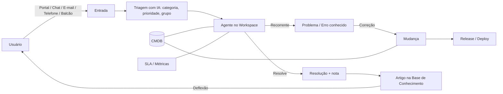
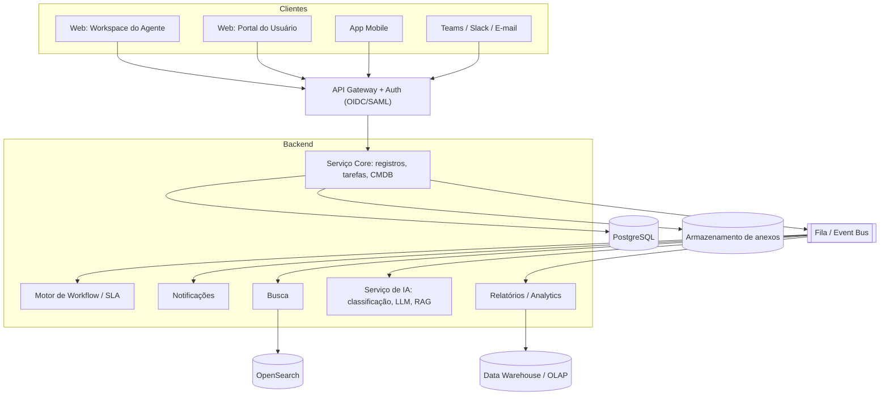
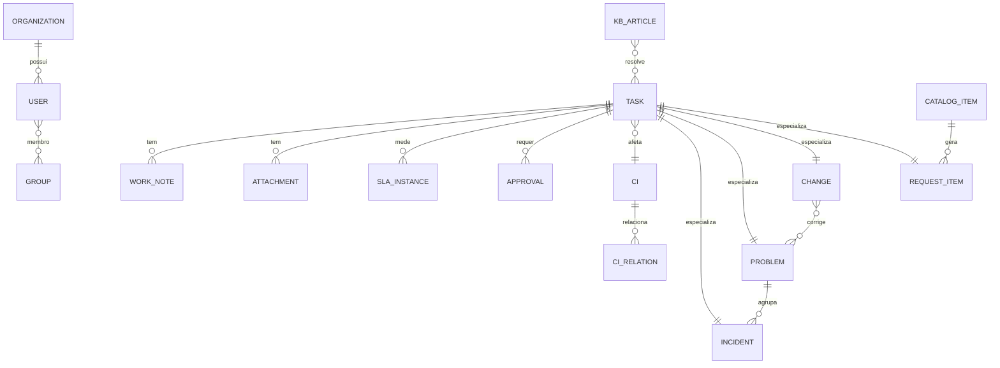

# Plano de Produto — Plataforma ITSM (inspirada no ServiceNow ITSM)

> [!NOTE]
> **Vídeo analisado:** O vídeo **ITSM Product Overview** (2m01s, Brightcove ID `6371180605112`) da página `https://www.servicenow.com/products/itsm.html` foi assistido e analisado parte por parte. A análise completa (segmento a segmento + transcrição + mapeamento para o backlog) está na **seção 12**.

---

## 1. Contexto: o que é o ITSM do ServiceNow

ITSM (IT Service Management) é o conjunto de processos e ferramentas que a TI usa para **entregar e dar suporte a serviços** aos usuários da empresa, baseado nas práticas ITIL. No ServiceNow, o ITSM roda sobre a "Now Platform" (banco único, workflow, portal, relatórios, IA) e se divide em três pacotes:

| Pacote | O que acrescenta |
|---|---|
| **Standard** | Incidentes, Problemas, Mudanças, Releases, Requisições/Catálogo, Base de Conhecimento, CMDB, SLAs, Portal de autoatendimento, App mobile, relatórios básicos |
| **Pro** | Predictive Intelligence (ML para classificar/rotear), Virtual Agent (chatbot), Performance Analytics (KPIs/tendências), Gestão de Incidentes Graves (MIM), Walk-up Experience, DevOps Change Velocity, Continual Improvement Management, Tradução dinâmica |
| **Enterprise / Pro Plus** | Now Assist (IA generativa: resumos, notas de resolução, rascunho de artigos), Workforce Optimization (escalas, habilidades), Process Mining (gargalos de processo) |

**A interface central é o *Service Operations Workspace* (SOW):** uma tela única para o agente com lista de trabalho, registro aberto, painel lateral contextual (incidentes parecidos, artigos sugeridos, alertas, recomendações da IA) e ações rápidas.

### Fluxo de ponta a ponta

---

## 2. Visão do produto

**Uma plataforma de gestão de serviços de TI dedicada (single-tenant, instalada para uma única empresa), que concentra todas as solicitações e falhas de TI em um só lugar, oferece autoatendimento ao usuário final, configuração no-code para administradores e, nas fases futuras, IA para triagem e apoio ao agente.**

**Objetivos mensuráveis (produto completo)**
- Reduzir o tempo médio de resolução (MTTR) em 30% em relação à ferramenta anterior do cliente.
- ≥ 25% de deflexão via portal/base de conhecimento/chatbot.
- ≥ 80% de acerto na classificação automática (categoria + grupo).
- Cumprimento de SLA ≥ 95%.

---

## 3. Personas

| Persona | Necessidade principal |
|---|---|
| **Usuário final (solicitante)** | Abrir chamado ou pedido rápido, acompanhar status, resolver sozinho |
| **Agente N1 (Service Desk)** | Receber, classificar, resolver ou escalar rapidamente |
| **Resolvedor N2/N3** | Trabalhar a fila do grupo, colaborar, documentar |
| **Gestor de Incidentes Graves** | Coordenar crise, comunicar partes interessadas |
| **Gestor de Problemas** | Analisar causa raiz, registrar erros conhecidos |
| **Gestor de Mudanças / CAB** | Avaliar risco, aprovar, agendar sem conflitos |
| **Aprovador** (gestor de área) | Aprovar pedidos e mudanças com um clique |
| **Gestor do Service Desk** | Painéis, SLA, carga das equipes |
| **Autor/Revisor de Conhecimento** | Criar, revisar e publicar artigos |
| **Administrador da plataforma** | Configurar categorias, grupos, SLAs, catálogo, workflows e telas no-code |
| **Gestor de Configuração** | Manter a CMDB confiável |

---

## 4. Escopo do produto completo — módulos (Épicos)

| # | Épico | Pacote equivalente | MVP? |
|---|---|---|---|
| E01 | Plataforma base (setup da instância, auth, RBAC, auditoria) | Platform | ✅ |
| E02 | Gestão de Incidentes | Standard | ✅ |
| E03 | Workspace do Agente (SOW) | Standard | ✅ (parcial) |
| E04 | SLA / OLA e Calendários | Standard | ✅ |
| E05 | Notificações e canal de e-mail | Standard | ✅ |
| E06 | Portal de Autoatendimento | Standard | ✅ |
| E07 | Catálogo de Serviços e Requisições | Standard | ✅ (parcial) |
| E08 | Base de Conhecimento | Standard | ✅ (parcial) |
| E09 | Gestão de Problemas | Standard | ❌ |
| E10 | Gestão de Mudanças | Standard | ❌ |
| E11 | Gestão de Releases | Standard | ❌ |
| E12 | CMDB e Ativos | Standard | ✅ (mínimo) |
| E13 | Motor de Workflow e Aprovações | Platform | ✅ (parcial) |
| E14 | Relatórios e Dashboards | Standard | ✅ (parcial) |
| E15 | Performance Analytics (KPIs, tendências) | Pro | ❌ |
| E16 | Gestão de Incidentes Graves (MIM) | Pro | ❌ |
| E17 | Classificação/roteamento com ML | Pro | ❌ |
| E18 | Assistente de IA generativa (resumos, notas, artigos) | Enterprise | ❌ |
| E19 | Agente Virtual (chatbot) e chat ao vivo | Pro | ❌ |
| E20 | Walk-up (balcão presencial) | Pro | ❌ |
| E21 | Integração DevOps (mudanças automáticas via CI/CD) | Pro | ❌ |
| E22 | Melhoria Contínua (CIM) | Pro | ❌ |
| E23 | Gestão de Força de Trabalho (escalas, habilidades) | Enterprise | ❌ |
| E24 | Pesquisas de satisfação (CSAT) | Standard | ✅ (simples) |
| E25 | App Mobile | Standard | ❌ |
| E26 | Integrações e API pública | Platform | ✅ (API REST) |
| E27 | Administração e Configuração no-code | Platform | ✅ (parcial) |

---

## 5. Arquitetura proposta

**Stack recomendada (otimizada para desenvolvimento 1 pessoa + IA):**
- **Linguagem única (TypeScript ponta a ponta):** reduz troca de contexto e permite compartilhar schemas e validações (Zod) entre frontend, backend e workers.
- **Frontend:** Next.js (App Router) ou React + Vite + TypeScript + Tailwind CSS + shadcn/ui — ideal para construir o Workspace com abas e o Portal de autoatendimento com agilidade, além de WebSocket para tempo real.
- **Backend:** NestJS (ou Fastify) em **monólito modular** — organização clara por módulos (Incidentes, SLA, Catálogo, Conhecimento, Workflow, No-Code), fácil de testar e manter sem sobrecarga de microsserviços.
- **Dados e Filas:** PostgreSQL + Prisma ORM (ou Drizzle); busca via PostgreSQL Full-Text Search (`pg_trgm`) no MVP (evoluindo para OpenSearch na R2/R3); Redis + BullMQ para timers de SLA, fila de e-mails e motor de workflow; armazenamento de anexos compatível com S3 (MinIO local/on-premise ou AWS S3).
- **Motor No-Code:** metadados dinâmicos (JSON Schema / definição de campos e layouts no PostgreSQL) renderizados dinamicamente no frontend.
- **Infraestrutura:** Docker + Docker Compose (instalação simples on-premise ou em VM dedicada da empresa) com CI/CD (GitHub Actions).

### Modelo de dados central (simplificado)

> [!NOTE]
> Assim como no ServiceNow, todos os registros de trabalho herdam de uma entidade **TASK** (número, estado, responsável, grupo, prioridade, SLA, notas, anexos, auditoria). Isso permite reaproveitar workspace, SLA, notificações e relatórios para todos os módulos.

---

## 6. Requisitos não funcionais

| Item | Meta |
|---|---|
| Disponibilidade | 99,9% mensal |
| Desempenho | Listas e formulários < 1 s (p95); busca < 500 ms |
| Escala | Até 500 agentes simultâneos / 1 milhão de registros na instância |
| Segurança | OWASP ASVS nível 2, criptografia em trânsito e em repouso, SSO, MFA |
| LGPD | Mascaramento de dados pessoais, retenção configurável, exportação/exclusão de dados do titular |
| Auditoria | Histórico de todos os campos, imutável |
| Acessibilidade | WCAG 2.1 AA |
| Idiomas | pt-BR, en, es |
| Backup | RPO 15 min, RTO 4 h |

---

## 7. Fases (waterfall)

```mermaid
flowchart LR
    F0["F0 Descoberta e Requisitos (1 sem)"] --> F1["F1 Design: UX + Arquitetura (2 sem)"]
    F1 --> F2["F2 Construção MVP (12 sem)"]
    F2 --> F3["F3 Testes e Homologação MVP (2 sem)"]
    F3 --> F4["F4 Go-live MVP / Piloto (1 sem)"]
    F4 --> F5["F5 Release 2: Problemas, Mudanças, CMDB completa, PA (12 sem)"]
    F5 --> F6["F6 Release 3: IA, MIM, Chatbot, Walk-up, DevOps, Mobile (14 sem)"]
    F6 --> F7["F7 Release 4: WFO, CIM, Process Mining (6 sem)"]
```

**Entregáveis por fase:** F0 → documento de requisitos aprovado e backlog fechado · F1 → protótipos navegáveis, arquitetura, modelo de dados, plano de testes · F2 → código + testes automatizados · F3 → relatório de testes, aceite do usuário · F4 → produção + suporte de hipercuidado.

> [!NOTE]
> **Estimativa ajustada para o time real (1 pessoa + IA):** O modelo single-tenant e a remoção de IA do MVP reduzem significativamente a complexidade inicial, resultando em ~**18 semanas** até o Go-live do MVP (mesmo incluindo o motor de configuração no-code).

---

## 8. Definição do MVP

**Objetivo:** substituir uma ferramenta de chamados simples em um service desk real, com Incidentes + Requisições + Conhecimento + SLA + Portal + Workspace.

**Fica de fora do MVP:** Problemas, Mudanças, Releases, IA, chatbot, MIM, mobile nativo, analytics avançado.

---

## 9. Backlog completo de histórias

Legenda: **MVP** = entra no MVP · **R2/R3/R4** = release posterior. Formato: *Como [persona], quero [ação], para [benefício].*

### E01 — Plataforma base
| ID | História | Rel. |
|---|---|---|
| US-001 | Como admin, quero configurar os dados iniciais da empresa (nome, logo, domínio de e-mail, fuso horário), para preparar a instância para uso | MVP |
| US-002 | Como usuário, quero entrar com e-mail/senha e MFA, para acessar com segurança | MVP |
| US-003 | Como admin, quero configurar SSO (SAML/OIDC com Azure AD/Google), para que os funcionários usem a conta corporativa | MVP |
| US-004 | Como admin, quero importar usuários e grupos (CSV e SCIM), para não cadastrar manualmente | MVP |
| US-005 | Como admin, quero definir papéis (usuário, agente, gestor, admin) e permissões por módulo, para controlar o acesso | MVP |
| US-006 | Como auditor, quero ver o histórico de alterações de qualquer registro (quem, quando, valor antigo/novo), para garantir rastreabilidade | MVP |
| US-007 | Como admin, quero regras de acesso por campo e por linha (ex.: RH vê só seus chamados), para proteger dados sensíveis | R2 |
| US-008 | Como usuário, quero a interface em pt-BR/en/es, para usar no meu idioma | MVP |
| US-009 | Como encarregado de dados (DPO), quero mascarar, exportar e apagar dados pessoais, para atender à LGPD | R2 |
| US-010 | Como admin, quero delegar (fora do escritório) aprovações e tarefas, para não travar o fluxo | R2 |

**Critérios de aceite (exemplo — US-005):**
- Dado um usuário com papel "usuário", quando acessar `/workspace`, então recebe 403.
- Papéis são combináveis; permissões são somadas.
- Toda mudança de papel fica registrada na auditoria.

### E02 — Gestão de Incidentes
| ID | História | Rel. |
|---|---|---|
| US-020 | Como agente, quero registrar um incidente com solicitante, categoria/subcategoria, item afetado, descrição e anexos, para documentar a falha | MVP |
| US-021 | Como sistema, quero calcular a prioridade a partir da matriz Impacto × Urgência, para padronizar a priorização | MVP |
| US-022 | Como agente, quero mover o incidente pelos estados Novo → Em andamento → Em espera (com motivo) → Resolvido → Fechado / Cancelado, para refletir o ciclo de vida | MVP |
| US-023 | Como agente, quero atribuir a um grupo e a uma pessoa, e reatribuir com justificativa, para encaminhar ao time certo | MVP |
| US-024 | Como sistema, quero aplicar regras de atribuição automática por categoria/local/CI, para reduzir triagem manual | MVP |
| US-025 | Como agente, quero separar *notas de trabalho* (internas) de *comentários* (visíveis ao usuário), para comunicar sem expor informação interna | MVP |
| US-026 | Como usuário, quero reabrir um incidente resolvido em até N dias, para quando o problema voltar | MVP |
| US-027 | Como sistema, quero fechar automaticamente incidentes resolvidos após N dias, para manter a fila limpa | MVP |
| US-028 | Como agente, quero exigir código e nota de resolução ao resolver, para ter dados de qualidade | MVP |
| US-029 | Como agente, quero vincular incidentes parecidos como filhos de um pai, e que resolver o pai resolva os filhos, para tratar falhas em massa | MVP |
| US-030 | Como agente, quero criar tarefas de incidente para outros grupos, para trabalhar em paralelo | R2 |
| US-031 | Como agente, quero criar um Problema ou uma Mudança a partir do incidente, para seguir o fluxo ITIL | R2 |
| US-032 | Como gestor, quero regras de escalonamento (funcional e hierárquica) por tempo/prioridade, para não deixar chamados parados | MVP |
| US-033 | Como agente, quero usar modelos de incidente (templates), para preencher casos comuns rapidamente | MVP |
| US-034 | Como agente, quero ver incidentes ativos no mesmo CI/serviço, para identificar falhas generalizadas | R2 |

**Critérios de aceite (exemplo — US-021):**
- Matriz configurável por tenant (padrão 3×3 → P1…P5).
- Ao alterar impacto ou urgência, a prioridade é recalculada na hora e auditada.
- O agente com permissão pode sobrescrever a prioridade, informando o motivo.

### E03 — Workspace do Agente
| ID | História | Rel. |
|---|---|---|
| US-040 | Como agente, quero uma página inicial com "Meu trabalho", "Fila do meu grupo", "Não atribuídos" e "SLA vencendo", para saber o que fazer primeiro | MVP |
| US-041 | Como agente, quero listas com filtro, ordenação, colunas configuráveis e filtros salvos, para organizar minha fila | MVP |
| US-042 | Como agente, quero abrir vários registros em abas dentro do workspace, para trabalhar em paralelo | MVP |
| US-043 | Como agente, quero um painel lateral com dados do solicitante, chamados recentes dele e CI afetado, para ter contexto sem trocar de tela | MVP |
| US-044 | Como agente, quero ver artigos e incidentes resolvidos parecidos no painel lateral, para resolver mais rápido | MVP |
| US-045 | Como agente, quero uma linha do tempo única (notas, comentários, e-mails, mudanças de campo, SLA), para entender o histórico | MVP |
| US-046 | Como agente, quero atualizar muitos registros de uma vez, para ganhar tempo | MVP |
| US-047 | Como agente, quero atalhos de teclado e ações rápidas (atribuir a mim, resolver, colocar em espera), para trabalhar mais rápido | MVP |
| US-048 | Como agente, quero ver atualizações em tempo real e saber se outro agente está editando o mesmo registro, para evitar conflito | MVP |
| US-049 | Como agente, quero respostas prontas (canned responses) com variáveis, para padronizar a comunicação | R2 |
| US-050 | Como agente, quero um painel de alertas e saúde de serviços (integração com monitoramento), para conectar falhas técnicas a incidentes | R3 |
| US-051 | Como agente, quero uma busca global em todos os registros e artigos, para achar qualquer coisa rapidamente | MVP |

### E04 — SLA / OLA
| ID | História | Rel. |
|---|---|---|
| US-060 | Como admin, quero definir SLAs de resposta e de resolução com condições de início, pausa, parada e reinício, para medir o atendimento | MVP |
| US-061 | Como admin, quero calendários de expediente e feriados por região, para calcular SLA em horário comercial | MVP |
| US-062 | Como agente, quero ver o cronômetro e a % consumida do SLA no registro e na lista, com cores, para priorizar | MVP |
| US-063 | Como sistema, quero notificar em 50%, 75% e 100% do SLA, para evitar violações | MVP |
| US-064 | Como admin, quero OLAs entre grupos internos e contratos de fornecedor (UC), para medir cada parte | R2 |
| US-065 | Como gestor, quero relatório de cumprimento de SLA por grupo, prioridade e período, para gerir desempenho | MVP |
| US-066 | Como admin, quero recalcular SLAs ao mudar a prioridade, para manter a medição correta | MVP |

### E05 — Notificações e e-mail
| ID | História | Rel. |
|---|---|---|
| US-070 | Como usuário, quero receber e-mail ao abrir, atualizar e resolver meu chamado, para acompanhar | MVP |
| US-071 | Como usuário, quero abrir um chamado enviando e-mail para uma caixa, para usar um canal conhecido | MVP |
| US-072 | Como usuário, quero responder o e-mail e ter a resposta como comentário no chamado, para conversar sem abrir o portal | MVP |
| US-073 | Como admin, quero editar modelos de notificação com variáveis e condições, para personalizar a comunicação | MVP |
| US-074 | Como usuário, quero escolher minhas preferências (e-mail, in-app, Teams/Slack), para receber do jeito que prefiro | R2 |
| US-075 | Como agente, quero notificações no app (sininho) em tempo real, para reagir rápido | MVP |

### E06 — Portal de Autoatendimento
| ID | História | Rel. |
|---|---|---|
| US-080 | Como usuário, quero uma página inicial com busca, "Preciso de ajuda", "Quero pedir algo" e "Meus chamados", para resolver sozinho | MVP |
| US-081 | Como usuário, quero abrir um incidente com formulário simples e ver artigos sugeridos enquanto digito, para talvez nem precisar abrir | MVP |
| US-082 | Como usuário, quero acompanhar e comentar meus chamados e pedidos, para saber o andamento | MVP |
| US-083 | Como usuário, quero aprovar ou rejeitar pedidos pendentes comigo no portal, para não travar o processo | MVP |
| US-084 | Como admin, quero personalizar logo, cores e banners, para refletir a marca da empresa | MVP |
| US-085 | Como usuário, quero ver avisos de indisponibilidade de serviços, para não abrir chamado repetido | R2 |
| US-086 | Como admin, quero montar páginas do portal com componentes arrastáveis, para adaptar sem código | R3 |

### E07 — Catálogo de Serviços e Requisições
| ID | História | Rel. |
|---|---|---|
| US-090 | Como admin, quero criar itens de catálogo com categorias, descrição, imagem, preço e prazo, para oferecer serviços | MVP |
| US-091 | Como admin, quero um construtor de formulários (texto, lista, data, referência a usuário/CI, anexo) com campos condicionais, para coletar o que é preciso | MVP |
| US-092 | Como usuário, quero pedir um ou vários itens (carrinho) para mim ou para outra pessoa, para resolver de uma vez | MVP |
| US-093 | Como sistema, quero gerar Requisição → Item → Tarefas de atendimento conforme o fluxo do item, para organizar a entrega | MVP |
| US-094 | Como aprovador, quero aprovar por e-mail ou portal (gestor, grupo, valor), para dar agilidade | MVP |
| US-095 | Como admin, quero restringir itens por perfil, departamento ou local, para mostrar só o que é aplicável | R2 |
| US-096 | Como admin, quero pacotes (ex.: "Kit novo colaborador"), para pedidos compostos | R2 |
| US-097 | Como admin, quero que um item dispare automação (ex.: criar conta no AD via integração), para atender sem trabalho manual | R3 |

### E08 — Base de Conhecimento
| ID | História | Rel. |
|---|---|---|
| US-100 | Como autor, quero escrever artigos em editor rico com imagens, para documentar soluções | MVP |
| US-101 | Como revisor, quero o fluxo Rascunho → Revisão → Publicado → Aposentado, para garantir qualidade | MVP |
| US-102 | Como admin, quero várias bases (TI, RH, interna de agentes) com permissões de leitura/escrita, para separar públicos | MVP |
| US-103 | Como usuário, quero buscar artigos com tolerância a erros de digitação e sinônimos, para achar respostas | MVP |
| US-104 | Como usuário, quero avaliar o artigo (útil/não útil, estrelas, comentário), para ajudar a melhorar | MVP |
| US-105 | Como agente, quero criar um artigo a partir de um incidente resolvido, para reaproveitar a solução | MVP |
| US-106 | Como agente, quero anexar um artigo ao chamado como solução, para medir uso dos artigos | MVP |
| US-107 | Como admin, quero versões dos artigos e data de validade com aviso ao dono, para manter o conteúdo atualizado | R2 |
| US-108 | Como gestor, quero relatório de artigos mais usados, sem uso e com nota baixa, para gerir o conteúdo | R2 |
| US-109 | Como usuário, quero tradução automática de artigos, para ler no meu idioma | R3 |

### E09 — Gestão de Problemas (R2)
| ID | História | Rel. |
|---|---|---|
| US-120 | Como gestor de problemas, quero registrar um problema e vincular vários incidentes, para tratar a causa | R2 |
| US-121 | Como gestor, quero estados Novo → Avaliação → Análise de causa raiz → Correção em andamento → Resolvido → Fechado | R2 |
| US-122 | Como analista, quero registrar causa raiz (5 porquês, Ishikawa) e solução de contorno, para documentar | R2 |
| US-123 | Como analista, quero publicar um Erro Conhecido com solução de contorno visível aos agentes, para acelerar o atendimento | R2 |
| US-124 | Como sistema, quero resolver incidentes vinculados quando o problema for resolvido, notificando os usuários | R2 |
| US-125 | Como gestor, quero tarefas de problema para outros grupos, para dividir a análise | R2 |
| US-126 | Como gestor, quero ver incidentes recorrentes (mesmo CI/categoria) sugeridos como candidatos a problema, para ser proativo | R3 |

### E10 — Gestão de Mudanças (R2)
| ID | História | Rel. |
|---|---|---|
| US-140 | Como solicitante, quero criar mudanças Padrão (pré-aprovada, de modelo), Normal e Emergencial, para seguir o fluxo correto | R2 |
| US-141 | Como solicitante, quero informar justificativa, plano de implementação, plano de rollback, plano de teste, janela e CIs afetados | R2 |
| US-142 | Como sistema, quero calcular o risco por questionário + histórico de falhas do CI, para orientar a aprovação | R2 |
| US-143 | Como gestor, quero aprovações por etapa (técnica, CAB, negócio) conforme tipo e risco | R2 |
| US-144 | Como gestor, quero um calendário de mudanças com janelas de manutenção e períodos de congelamento, para evitar conflitos | R2 |
| US-145 | Como sistema, quero detectar conflitos (mesmo CI, mesmo horário, fora da janela), para alertar antes de aprovar | R2 |
| US-146 | Como CAB, quero agenda de reunião com a lista de mudanças a avaliar e registro das decisões | R2 |
| US-147 | Como implementador, quero tarefas de mudança e registro do resultado (sucesso, falha, rollback) | R2 |
| US-148 | Como gestor, quero revisão pós-implementação (PIR) para mudanças com falha | R2 |
| US-149 | Como admin, quero um catálogo de mudanças padrão, para agilizar mudanças repetitivas | R2 |
| US-150 | Como analista, quero ver o impacto da mudança nos serviços via CMDB, para avaliar riscos | R2 |

### E11 — Releases (R2)
| ID | História | Rel. |
|---|---|---|
| US-160 | Como gestor de release, quero agrupar mudanças em uma release com fases e datas | R2 |
| US-161 | Como gestor, quero tarefas de release e checklist de go/no-go | R2 |
| US-162 | Como gestor, quero acompanhar o status da release em um painel | R2 |

### E12 — CMDB e Ativos
| ID | História | Rel. |
|---|---|---|
| US-170 | Como admin, quero cadastrar Itens de Configuração (servidor, computador, aplicação, banco, rede) com atributos por classe | MVP |
| US-171 | Como admin, quero importar CIs via CSV | MVP |
| US-172 | Como gestor de configuração, quero relacionar CIs (depende de, roda em, conecta a) | R2 |
| US-173 | Como analista, quero ver o mapa de dependências de um serviço em gráfico | R2 |
| US-174 | Como admin, quero definir Serviços de Negócio e Técnicos com donos e criticidade | R2 |
| US-175 | Como sistema, quero regras de identificação e reconciliação para evitar CIs duplicados vindos de várias fontes | R2 |
| US-176 | Como gestor, quero painel de saúde da CMDB (completude, duplicidade, desatualização) | R3 |
| US-177 | Como admin, quero integrar fontes de descoberta (Intune, SCCM, AWS, Azure) | R3 |
| US-178 | Como gestor de ativos, quero ciclo de vida do ativo de hardware (compra, estoque, em uso, descarte) | R3 |

### E13 — Workflow e Aprovações
| ID | História | Rel. |
|---|---|---|
| US-190 | Como admin, quero um editor visual de fluxos (gatilho, condição, aprovação, tarefa, notificação, espera, atualizar registro) | MVP (básico) |
| US-191 | Como admin, quero regras de negócio sem código ("quando campo X mudar, faça Y") | MVP |
| US-192 | Como admin, quero versionar e testar fluxos antes de publicar | R2 |
| US-193 | Como admin, quero ações de integração (chamar REST, webhook) dentro do fluxo | R2 |
| US-194 | Como admin, quero tarefas agendadas (ex.: abrir chamado preventivo todo mês) | R2 |

### E14 — Relatórios e Dashboards
| ID | História | Rel. |
|---|---|---|
| US-200 | Como gestor, quero dashboards prontos do service desk (abertos, backlog, por prioridade, por grupo, SLA) | MVP |
| US-201 | Como gestor, quero criar relatórios (lista, barras, pizza, linha, indicador) sem código | MVP |
| US-202 | Como gestor, quero agendar envio de relatórios por e-mail | R2 |
| US-203 | Como gestor, quero exportar listas para CSV/Excel/PDF | MVP |
| US-204 | Como gestor, quero compartilhar dashboards com papéis/grupos | R2 |

### E15 — Performance Analytics (R2)
| ID | História | Rel. |
|---|---|---|
| US-210 | Como gestor, quero KPIs com histórico diário (MTTR, FCR, backlog, reabertura, % SLA) | R2 |
| US-211 | Como gestor, quero metas e limites com alertas | R2 |
| US-212 | Como gestor, quero detalhar (drill-down) por grupo, categoria, agente | R2 |
| US-213 | Como gestor, quero previsão de volume de chamados | R3 |

### E16 — Incidentes Graves / MIM (R3)
| ID | História | Rel. |
|---|---|---|
| US-220 | Como agente, quero propor um incidente como grave, e o gestor aceitar/rejeitar | R3 |
| US-221 | Como gestor de MIM, quero um workspace de crise com linha do tempo, tarefas, participantes e serviços afetados | R3 |
| US-222 | Como gestor de MIM, quero criar sala de guerra no Teams/Slack automaticamente | R3 |
| US-223 | Como gestor, quero enviar comunicados a partes interessadas por modelos e canais (e-mail, SMS) | R3 |
| US-224 | Como gestor, quero gerar relatório pós-incidente (PIR) com linha do tempo automática | R3 |
| US-225 | Como sistema, quero sugerir incidente grave quando houver pico de chamados semelhantes | R3 |

### E17 — Classificação/roteamento com ML (R3)
| ID | História | Rel. |
|---|---|---|
| US-230 | Como sistema, quero prever categoria, prioridade e grupo a partir do texto do chamado | R3 |
| US-231 | Como admin, quero treinar e reavaliar o modelo com o histórico do tenant e ver a precisão | R3 |
| US-232 | Como admin, quero definir limiar de confiança para aplicar automaticamente ou só sugerir | R3 |
| US-233 | Como agente, quero aceitar ou corrigir a sugestão, e que a correção alimente o modelo | R3 |
| US-234 | Como sistema, quero agrupar incidentes semelhantes (clustering) para apoiar Problemas | R3 |

### E18 — IA generativa para agentes (R3)
| ID | História | Rel. |
|---|---|---|
| US-240 | Como agente, quero um resumo do incidente com um clique (histórico, ações, situação atual) | R3 |
| US-241 | Como agente, quero que a IA rascunhe a nota de resolução ao resolver | R3 |
| US-242 | Como agente, quero que a IA rascunhe um artigo a partir do incidente resolvido | R3 |
| US-243 | Como agente, quero sugestões de resposta ao usuário no tom adequado | R3 |
| US-244 | Como usuário, quero busca no portal com resposta gerada a partir dos artigos (RAG), com links das fontes | R3 |
| US-245 | Como analista de mudança, quero resumo de risco e histórico da mudança | R3 |
| US-246 | Como admin, quero ligar/desligar cada recurso de IA e registrar uso/custo, sem enviar dados para treinar modelos de terceiros | R3 |

### E19 — Agente Virtual e Chat (R3)
| ID | História | Rel. |
|---|---|---|
| US-250 | Como usuário, quero conversar com um chatbot no portal e no Teams/Slack | R3 |
| US-251 | Como admin, quero desenhar conversas (redefinir senha, status do chamado, pedir item) num editor visual | R3 |
| US-252 | Como bot, quero entender a intenção em linguagem natural | R3 |
| US-253 | Como usuário, quero ser transferido para um agente humano com o contexto da conversa | R3 |
| US-254 | Como agente, quero atender chats ao vivo no workspace com fila e limite de chats simultâneos | R3 |

### E20 — Walk-up / Balcão (R3)
| ID | História | Rel. |
|---|---|---|
| US-260 | Como usuário, quero fazer check-in online ou no totem e ver a posição na fila | R3 |
| US-261 | Como usuário, quero agendar horário no balcão de TI | R3 |
| US-262 | Como técnico, quero uma fila do balcão e registrar o atendimento vinculado a incidente/ativo | R3 |

### E21 — Integração DevOps (R3)
| ID | História | Rel. |
|---|---|---|
| US-270 | Como engenheiro, quero que o pipeline (GitHub/GitLab/Azure DevOps/Jenkins) crie a mudança automaticamente | R3 |
| US-271 | Como gestor, quero políticas que aprovem automaticamente mudanças de baixo risco (testes passaram, cobertura ok) | R3 |
| US-272 | Como auditor, quero ver commits, builds e testes vinculados à mudança | R3 |

### E22 — Melhoria Contínua (R4)
| ID | História | Rel. |
|---|---|---|
| US-280 | Como gestor, quero registrar iniciativas de melhoria com metas, KPIs e tarefas | R4 |
| US-281 | Como gestor, quero vincular a melhoria a problemas/KPIs e acompanhar o resultado | R4 |

### E23 — Força de Trabalho (R4)
| ID | História | Rel. |
|---|---|---|
| US-290 | Como gestor, quero cadastrar escalas, plantões e habilidades dos agentes | R4 |
| US-291 | Como sistema, quero atribuir chamados por habilidade, disponibilidade e carga | R4 |
| US-292 | Como gestor, quero painel de carga e produtividade da equipe | R4 |
| US-293 | Como gestor, quero escala de plantão com acionamento (on-call) para P1 | R3 |
| US-294 | Como gestor, quero mineração de processos para ver gargalos e retrabalho | R4 |

### E24 — Pesquisas de satisfação
| ID | História | Rel. |
|---|---|---|
| US-300 | Como usuário, quero responder uma pesquisa curta (1–5 + comentário) ao fechar o chamado | MVP |
| US-301 | Como gestor, quero relatório de CSAT por grupo/agente | MVP |
| US-302 | Como admin, quero criar pesquisas personalizadas e regras de envio | R2 |

### E25 — App Mobile (R3)
| ID | História | Rel. |
|---|---|---|
| US-310 | Como usuário, quero abrir e acompanhar chamados e aprovar pedidos pelo celular | R3 |
| US-311 | Como agente, quero trabalhar minha fila pelo celular com notificações push | R3 |
| US-312 | Como técnico de campo, quero ler código de barras/QR do ativo | R3 |

### E26 — Integrações e API
| ID | História | Rel. |
|---|---|---|
| US-320 | Como desenvolvedor, quero API REST documentada (OpenAPI) para todos os registros, com tokens por aplicação | MVP |
| US-321 | Como desenvolvedor, quero webhooks de eventos (criado, atualizado, resolvido) | MVP |
| US-322 | Como admin, quero conectores prontos (Teams, Slack, Jira, Azure AD, monitoramento) | R2/R3 |
| US-323 | Como admin, quero importação agendada de dados com mapeamento de campos | R2 |
| US-324 | Como admin, quero migrar dados de outra ferramenta (ServiceNow, Jira SM, GLPI) | R2 |

### E27 — Administração e Configuração
| ID | História | Rel. |
|---|---|---|
| US-330 | Como admin, quero gerenciar categorias, subcategorias, códigos de resolução e motivos de espera | MVP |
| US-331 | Como admin, quero gerenciar grupos, membros, gestor e e-mail do grupo | MVP |
| US-332 | Como admin, quero cadastrar locais, departamentos e empresas | MVP |
| US-333 | Como admin, quero adicionar campos personalizados e alterar o layout de formulários sem código, para adaptar a plataforma à empresa | MVP |
| US-334 | Como admin, quero tornar campos obrigatórios/visíveis/somente leitura conforme condições | MVP |
| US-335 | Como admin, quero mover configurações entre ambientes (homologação → produção) | R2 |

---

## 10. Resumo do MVP

| Épico | Histórias MVP |
|---|---|
| E01 Plataforma | US-001 a 006, 008 |
| E02 Incidentes | US-020 a 029, 032, 033 |
| E03 Workspace | US-040 a 048, 051 |
| E04 SLA | US-060 a 063, 065, 066 |
| E05 Notificações | US-070 a 073, 075 |
| E06 Portal | US-080 a 084 |
| E07 Catálogo | US-090 a 094 |
| E08 Conhecimento | US-100 a 106 |
| E12 CMDB | US-170, 171 |
| E13 Workflow | US-190 (básico), 191 |
| E14 Relatórios | US-200, 201, 203 |
| E24 CSAT | US-300, 301 |
| E26 API | US-320, 321 |
| E27 Admin | US-330 a 334 |

**Total aproximado:** ~70 histórias no MVP, ~165 no produto completo.

### Critérios de saída do MVP
- 100% das histórias MVP aceitas pelo PO.
- 0 defeitos críticos/altos abertos.
- Teste de carga: 500 agentes simultâneos, p95 < 1 s.
- Pentest sem vulnerabilidades altas.
- Piloto com 1 cliente por 2 semanas com SLA medido corretamente.

---

## 11. Decisões fechadas

1. **Modelo de implantação:** Single-tenant (instalado exclusivamente para uma empresa).
2. **Stack definida:** TypeScript ponta a ponta — Frontend em Next.js/React + Tailwind + shadcn/ui; Backend em NestJS (monólito modular) + Prisma; Banco PostgreSQL; Filas/timers em Redis + BullMQ; Anexos compatíveis com S3 (MinIO/S3); Empacotamento em Docker.
3. **Time e cronograma:** Desenvolvimento em dupla (1 pessoa + IA), com previsão de **~18 semanas** para o Go-live do MVP (Seção 7).
4. **IA no MVP:** **Não entra no MVP.** Recursos de ML e IA generativa (E17, E18, E19) permanecem na Release 3.
5. **Configuração no-code:** **Obrigatória desde o MVP.** Inclui construtor de formulários do catálogo (`US-091`), editor visual básico de fluxos (`US-190`), regras de negócio sem código (`US-191`), campos condicionais (`US-334`) e criação de campos personalizados/layout (`US-333`).

## 12. Análise do vídeo, parte por parte

- **Título:** ITSM Product Overview (`https://www.servicenow.com/products/itsm.html`, seção Hero)
- **Duração:** 2m01s (Player Brightcove `6371180605112`)
- **Mensagem central:** *"Unify incident, change, problem, and service request management on one platform. Use agentic AI to handle routine requests and move toward zero-touch service."*

### Decomposição por segmentos

| Tempo | O que aparece na tela (UI e recursos) | Narração (resumo) | Mapeamento no plano |
|---|---|---|---|
| **0:00 – 0:13** | Gestor de TI cercado por papéis/processos manuais; transição para nós conectados em uma plataforma única. | Ferramentas isoladas e processos manuais tornam a TI ingerenciável; hora de colocar IA para trabalhar pela TI. | E01 (Plataforma única), E02–E12 |
| **0:14 – 0:26** | **Service Operations Workspace** aberto no incidente `INC0022401` (*"Multiple users facing issue with Zoom app"*). Abas: `Overview`, `Investigation`, `Details`, `Communicate`, `Related records`, `Playbook`, `Post incident report`. Card **"Incident summarized by Now Assist"** (Issue, Key Actions Taken, link para `PRB0040004`, Caller, Assigned to, indicador de SLA). | O ServiceNow ITSM une IA, dados e fluxos de trabalho em todos os serviços de TI. | E03 (Workspace: US-042, US-043, US-045), E04 (SLA), E09 (Problema), E18 (US-240 resumo por IA) |
| **0:27 – 0:42** | Título *"MODERNIZE YOUR IT WITH AI AGENTS"* e diagramas de fluxos autônomos de triagem, mudança e problema. | Agentes de IA automatizam tarefas, reduzem custos e aceleram incidentes, mudanças e problemas. | E02, E09, E10, E13 (Workflow), E17/E18 |
| **0:43 – 0:55** | Painel do **Service Operations Workspace**: medidor circular **"Incident SLAs"** (389 rastreados, alerta `< 1 hour remaining: 2`), fila **"Unassigned incidents"** e roteamento automático via Machine Learning. | Rastreie e colabore em um só workspace; garanta o time certo com roteamento por ML. | E03 (US-040), E04 (US-062, US-063), E14 (US-200), E17 (US-230) |
| **0:56 – 1:07** | Tela **"New Knowledge - Article drafted by Now Assist"** gerada a partir do alerta `Alert0020114` (CPU > 90%), com campos estruturados: `Issue description`, `Steps to Reproduce`, `Root Cause Analysis`, `Resolution protocol`. | GenAI para resumos de incidentes, gestão de mudanças e geração automática de artigos de conhecimento. | E08 (US-105), E18 (US-242, US-245) |
| **1:08 – 1:26** | Experiência do colaborador (desktop e mobile): busca inteligente (*"answers, not search results"*) e bot **Now Support** executando **reset de senha no Microsoft Entra** com perguntas de verificação de identidade, sem agente humano. | Autoatendimento 24/7 com busca por IA, portal único e agentes virtuais integrados a ferramentas de comunicação. | E06 (US-080, US-081), E18 (US-244 RAG), E19 (US-250–252), E26 (integração Entra/Teams/Slack) |
| **1:27 – 1:40** | Notificações push em tempo real no **Now Mobile** mantendo funcionários atualizados sobre seus chamados. | Notificações em tempo real no aplicativo móvel mantêm os usuários informados em movimento. | E05, E25 (US-310, US-311) |
| **1:41 – 2:01** | Encerramento institucional: *"To put AI to work for IT"* e CTA `ServiceNow.com/ITSM`. | Resolver incidentes mais rápido e entregar experiências excepcionais na plataforma de IA. | Visão do produto (Seção 2) |

### Ajustes recomendados ao plano a partir do vídeo
1. **Abas do Workspace (US-042 / US-043):** padronizar a tela de registro do agente com abas inspiradas no SOW: `Overview`, `Investigation`, `Details`, `Communicate`, `Related records`, `Playbook` e `Post incident report` (para incidentes graves).
2. **Widget de SLA na Home do Workspace (US-040 / US-062):** incluir medidor circular com contagem de incidentes próximos do vencimento (`< 1h`) ao lado da fila de não atribuídos.
3. **Artigo de conhecimento gerado por IA (US-242):** estruturar o rascunho automático com as 4 seções vistas no vídeo (`Issue description`, `Steps to Reproduce`, `Root Cause Analysis`, `Resolution protocol`).
4. **Autoatendimento de reset de senha (US-251):** incluir fluxo pronto de verificação de identidade + integração com provedor de identidade (Microsoft Entra / AD) como caso de uso padrão do Agente Virtual.
