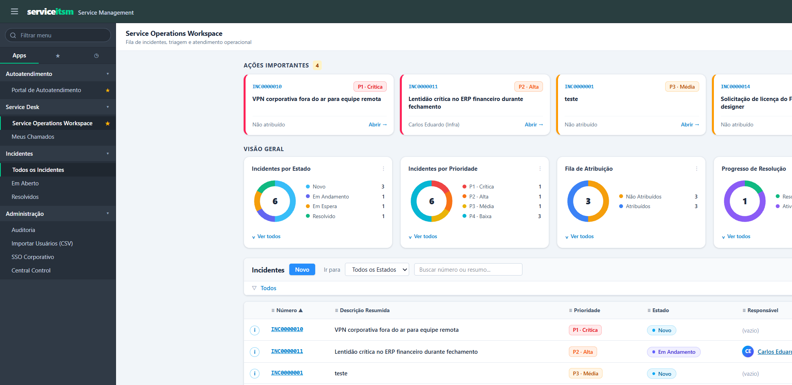
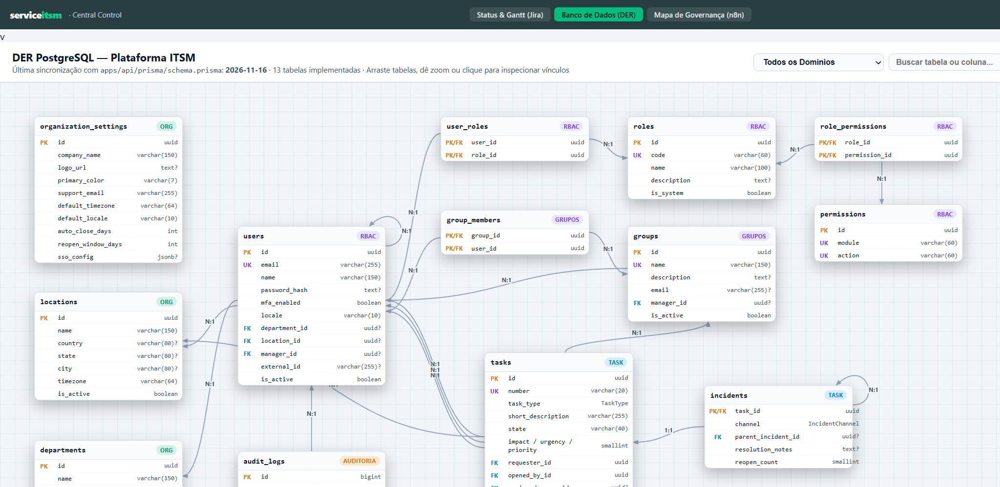
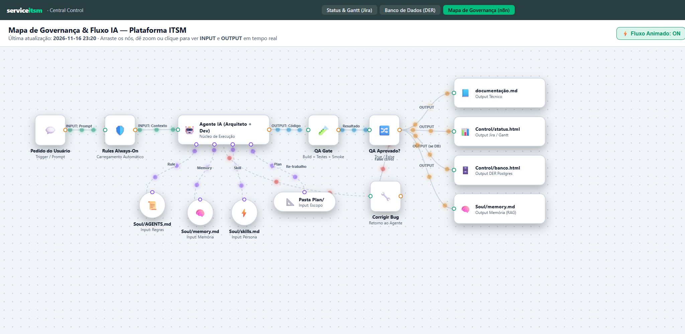

# Desafio Técnico ioasys — Plataforma ITSM

> **Do benchmarking em vídeo do ServiceNow à engenharia guiada por IA:** a história, a orquestração (`Plan` + `Soul` + `Control`), os desafios reais de engenharia e a construção incremental de uma plataforma ITSM *single-tenant* em **TypeScript ponta a ponta**.

---

## 1. Contexto & Evolução do Projeto

Este projeto não começou direto no código. Ele foi conduzido em **metodologia Waterfall em dupla direta (Produto/Arquitetura Humana + Agente de IA)**, tratando a IA não como um gerador de trechos isolados, mas como um time multidisciplinar governado por regras, memória persistente e painéis de controle.

1. **Descoberta & Benchmarking Real (`F0`):**
   - Analisamos o **ServiceNow ITSM** na prática — inclusive inspecionando o vídeo oficial *ITSM Product Overview* segmento a segmento via depuração remota do Chrome para mapear o *Service Operations Workspace* (SOW), a linha do tempo unificada, a deflexão por Base de Conhecimento no Portal e os fluxos ITIL.
2. **Alinhamento de Escopo & Arquitetura (`F1`):**
   - Fechamos **5 decisões estruturais**: arquitetura **single-tenant**, **TypeScript ponta a ponta** (`@itsm/shared` + NestJS + Next.js + Prisma), escopo MVP dimensionado para **1 pessoa + IA em 18 semanas**, **IA generativa fora do MVP** (planejada para R3) e **Motor No-Code obrigatório já no MVP**.
3. **Orquestração `Plan/` + `Soul/` + `Control/`:**
   - Para evitar que o projeto perdesse contexto entre sessões ou trocas de modelo, criamos uma **tríade de governança** (detalhada na seção 3) que obriga o agente a ler o estado atual antes de agir, passar por um **QA Gate** antes de concluir e atualizar painéis visuais vivos a cada entrega.
4. **Construção Incremental (`F2` — Em Andamento):**
   - Já entregamos **100% do Épico E01** (Setup, Auth/Argon2/MFA, SSO OIDC/SAML, CSV/SCIM 2.0, RBAC, Auditoria Imutável, i18n `pt-BR`/`en`/`es`), o **núcleo de Incidentes (E02)**, o **Portal de Autoatendimento (E06)**, o **Design System inspirado no ServiceNow** e a **Central Control (`/control`)**.

---

## 2. Prints da Aplicação em Funcionamento

### Service Operations Workspace (`/workspace`)


### Portal de Autoatendimento (`/portal`)


### Central Control (`/control`) — Status & Gantt (Jira)


### Central Control (`/control`) — DER PostgreSQL (Visual Paradigm)


### Central Control (`/control`) — Mapa de Governança (Fluxo Interativo)


---

## 3. A Orquestração: `Plan/` + `Soul/` + `Control/`

A maior diferenciação metodológica deste desafio está em como o repositório foi estruturado para **orquestrar humano + IA com rastreabilidade total**:

```text
Pedido do Usuário
   │
   ▼
[.agents/rules/itsm-workflow.md]  ──(carregada automaticamente em todo turno)
   │
   ├──► Soul/AGENTS.md    → Regras técnicas inegociáveis (herança TASK, BigInt, UI/UX, PowerShell)
   ├──► Soul/skills.md    → Persona (Arquiteto + Full-Stack + UI/UX Sênior + QA) & QA Gate
   ├──► Soul/memory.md    → Memória persistente (RAG) com decisões, armadilhas e ponto de parada
   └──► Plan/             → Contrato Waterfall (plano_itsm.md, modelo_dados_e_apis.md, criterios_aceite_mvp.md)
   │
   ▼
Construção (@itsm/shared → @itsm/api → @itsm/web) ──► QA Gate (Build + Tests + Smoke + UI)
   │
   ▼
Documentação Viva (DoD)
   ├──► documentação.md       → Apenas o que foi implementado e testado
   ├──► Control/status.html   → Painel Jira/Gantt atualizado por história
   ├──► Control/banco.html    → DER Visual Paradigm atualizado a cada mudança no schema.prisma
   └──► Control/mapping.html  → Mapa visual do próprio fluxo de governança
```

- **`Plan/` (O que construir e como validar):** Garante que nenhuma linha de código seja escrita sem história definida, modelo relacional planejado (`TASK`) e critérios Dado/Quando/Então.
- **`Soul/` (Como pensar e não esquecer):** Resolve o maior problema de projetos longos com LLM — a amnésia entre sessões. `Soul/memory.md` funciona como memória de longo prazo e `.agents/rules/itsm-workflow.md` garante aplicação automática.
- **`Control/` (Visibilidade em tempo real):** Transforma arquivos técnicos em painéis visuais acessíveis direto na rota **`/control`** da aplicação.

---

## 4. Desafios Reais Enfrentados & Soluções de Engenharia

Durante a construção, enfrentamos problemas reais de ambiente, runtime e usabilidade que moldaram a arquitetura final:

1. **PostgreSQL sem Docker Desktop (`Wsl/0x80070422` no Windows):**
   - *Desafio:* O ambiente local não possuía Docker Desktop/WSL2 ativo e o instalador gráfico travava por UAC.
   - *Solução:* Provisionamos binários portáteis oficiais do **PostgreSQL 16** em `.local/pgsql` (ignorado no `.gitignore`), inicializamos o cluster e aplicamos todas as migrations reais do Prisma (`20261116234607_init` e `20261117001505_add_incidents_e02`).
2. **Erro `500 Internal Server Error` por `BigInt` em `audit_logs`:**
   - *Desafio:* Ao abrir detalhes de um chamado no `/portal` autenticado como `admin`, a API quebrou com `Do not know how to serialize a BigInt` porque `audit_logs.id` é `BigInt` no PostgreSQL.
   - *Solução:* Convertemos explicitamente `id.toString()` em `AuditService` e `IncidentsService.findOne`, criamos teste de regressão específico e instituímos o **QA Gate** em `Soul/AGENTS.md` para barrar conclusões baseadas apenas em mocks.
3. **Isolamento estrito do `pnpm` v11 & Scripts Nativos:**
   - *Desafio:* O `pnpm` v11 bloqueava scripts de build nativos (`argon2`, `@prisma/engines`) e impedia importações não declaradas diretamente no pacote (`zod` usado dentro de `apps/api`).
   - *Solução:* Configuramos `pnpm.onlyBuiltDependencies` no `package.json` raiz e centralizamos contratos/validações em `@itsm/shared`.
4. **Quebra de API na versão v13 do `otplib`:**
   - *Desafio:* A versão `^13.6.0` instalada removeu o objeto legado `authenticator`.
   - *Solução:* Refatoramos o módulo de MFA para usar `generateSecret`, `generateSync`, `verifySync` e `generateURI`, documentando o aprendizado em `Soul/memory.md`.
5. **Reforma de UI/UX & Bug de i18n Misto (`pt-BR` com trechos em inglês):**
   - *Desafio:* A primeira versão das telas estava crua, com botões amontoados no topo, seletor de idioma branco sobre fundo branco e strings fixas em inglês mesmo com `pt-BR` ativo.
   - *Solução:* Construímos o `AppShell` inspirado no **ServiceNow Service Management** (barra `#293e40`, navegador lateral `#303a46` com *Filtrar menu*, *Apps / ★ Favoritos / ◷ Histórico*, `TopbarActions` sem engrenagem, `DonutChart`, `PriorityBadge`, `StateBadge`) e unificamos 100% das strings em `packages/shared/src/i18n.ts`.

---

## 5. O que Cada Épico Entrega na Prática (`Plan/plano_itsm.md`)

### Escopo MVP — 14 Épicos (71 Histórias · 18 Semanas)

| Épico | O que entrega de valor real | Status Atual |
|---|---|---|
| **E01 — Plataforma Base** | Setup single-tenant, Login + Argon2 + bloqueio + MFA TOTP, SSO (OIDC/SAML + JIT), Importação CSV (`dryRun`) & SCIM 2.0, RBAC, Auditoria imutável e i18n (`pt-BR`/`en`/`es`) | **100% Concluído** |
| **E02 — Gestão de Incidentes** | Abertura (`INC...`), matriz 3×3 Impacto×Urgência (`P1`–`P5`), ciclo de vida de estados, atribuição, notas internas vs. comentários públicos, resolução obrigatória, reabertura e Pai/Filho | **Núcleo Entregue** (faltam `US-024`, `027`, `032`, `033`) |
| **E06 — Portal de Autoatendimento** | Portal com branding da empresa, busca, abertura com deflexão por artigos sugeridos, acompanhamento, comentários públicos e reabertura | **Entregue** (`US-080`, `081` parcial, `082`, `084`) |
| **E03 — Workspace do Agente (SOW)** | Home com *Ações Importantes* + gráficos *Donut*, lista estilo ServiceNow, abas múltiplas de registros, painel lateral de contexto e busca global | **Iniciado** (`US-040` parcial) |
| **E27 — Admin & No-Code** | CRUD de categorias/grupos/locais, campos customizados (`JSONB`) e políticas condicionais de UI sem código | Pendente |
| **E04 — SLA / OLA & Calendários** | Definições de resposta/resolução, calendário comercial/feriados, cronômetro visual e alertas 50%/75%/100% via BullMQ | Pendente |
| **E05 — Notificações & E-mail** | E-mails transacionais, abertura/resposta de chamados por e-mail (inbound) e sininho in-app via WebSocket | Pendente |
| **E07 — Catálogo & Requisições** | Itens de catálogo, construtor de formulários condicionais, carrinho, hierarquia `REQ → RITM → SCTASK` e aprovações 1-clique | Pendente |
| **E08 — Base de Conhecimento** | Editor rico, fluxo editorial, múltiplas bases, busca tolerante a erros (`pg_trgm`) e criação de artigo a partir de incidente | Pendente |
| **E12 — CMDB Mínima** | Cadastro de Itens de Configuração (servidores, apps, notebooks, redes) por classe e importação CSV | Pendente |
| **E13 — Workflow No-Code** | Editor visual básico de fluxos assíncronos e regras de negócio sem código | Pendente |
| **E14 — Relatórios & Dashboards** | Dashboards prontos do Service Desk, construtor visual sem código e exportação CSV/Excel/PDF | Pendente |
| **E24 — Pesquisas CSAT** | Pesquisa 1–5 estrelas ao fechar chamado e relatório por grupo/agente | Pendente |
| **E26 — API & Webhooks** | API REST documentada (Swagger/OpenAPI), tokens por aplicação e webhooks assinados com retry | **Parcial** (`US-320` Swagger ativo) |

### Escopo Pós-MVP — 13 Épicos (Releases R2, R3 e R4)
- **R2 (ITIL Avançado & Analytics):** `E09` Gestão de Problemas & Erros Conhecidos · `E10` Gestão de Mudanças & CAB · `E11` Gestão de Releases · `E15` Performance Analytics (KPIs históricos).
- **R3 (Escala, Automação & IA):** `E16` Incidentes Graves (MIM) · `E17` Classificação/Roteamento com ML · `E18` IA Generativa (resumos, rascunhos, RAG) · `E19` Agente Virtual & Chat · `E20` Walk-up (balcão presencial) · `E21` Integração DevOps (CI/CD) · `E25` App Mobile.
- **R4 (Otimização Enterprise):** `E22` Melhoria Contínua (CIM) · `E23` Gestão de Força de Trabalho & Process Mining.

---

## 6. Próximos Passos (Roadmap Imediato)

1. **Fechar 100% do Épico E02 (Incidentes):** Implementar atribuição automática (`US-024`), fechamento automático após N dias (`US-027`), escalonamento (`US-032`) e templates de incidente (`US-033`).
2. **Completar E27 (Admin & Motor No-Code):** Telas administrativas de categorias/grupos/locais (`US-330`–`US-332`) e campos customizados + políticas condicionais em `JSONB` (`US-333`, `US-334`).
3. **Evoluir E03 (Service Operations Workspace):** Abas múltiplas de registros abertos (`US-042`), painel lateral de contexto do solicitante (`US-043`) e linha do tempo unificada (`US-045`).
4. **Ativar Workers Assíncronos (`E04` SLA + `E05` E-mail):** Conectar Redis + BullMQ para contagem de SLA em horário comercial e notificações em tempo real.
5. **Implementar E08 (Base de Conhecimento com `pg_trgm`):** Substituir os guias iniciais do `/portal` por artigos reais persistidos no PostgreSQL com deflexão medida.

---

## 7. Stack Tecnológica, Por que Essas Escolhas & Banco PostgreSQL

### Stack & Por que Usamos Essas Tecnologias

- **TypeScript ponta a ponta (Node.js `>= 22` + `pnpm` `11.1.2` + Zod `^3.24`):** Permite compartilhar tipos e schemas de validação (`@itsm/shared`) entre frontend e backend, reduzindo duplicação e erros de contrato.
- **NestJS `^11` + Prisma ORM `^6.3`:** O NestJS oferece arquitetura modular (ideal para separar domínios ITSM como Organização, Auth/SSO, Usuários/SCIM, Auditoria e Incidentes), injeção de dependência, guards RBAC e Swagger/OpenAPI. O Prisma entrega consultas tipadas e controle seguro de migrações.
- **Segurança nativa (Argon2id, JWT, `otplib` `^13.6`):** Argon2id garante hash resistente para senhas; JWT viabiliza sessões stateless (`accessToken`/`refreshToken`); `otplib` implementa MFA TOTP padrão de mercado.
- **Next.js `^15.2` (App Router) + React `^19` + Tailwind CSS `^4`:** Unifica o Portal (`/portal`), o Workspace (`/workspace`) e a Central Control (`/control`) em uma aplicação moderna, responsiva e consistente em Light/Dark Mode.
- **PostgreSQL `16`, Redis `7` e MinIO (`docker-compose.yml`):** PostgreSQL atende tanto o modelo relacional rígido quanto campos dinâmicos; Redis suporta cache/filas assíncronas (BullMQ); MinIO provê armazenamento S3 local para anexos.

### Banco de Dados PostgreSQL & Dump SQL

- **Por que PostgreSQL?** Suporta integridade relacional ACID para o núcleo unificado `tasks`, `JSONB` para os campos customizados do motor *no-code* (`tasks.custom_fields`) e extensão `pg_trgm` para busca tolerante a erros na Base de Conhecimento.
- **Herança lógica `TASK`:** Todo registro de trabalho (`INCIDENT`, `REQUEST`, `REQUEST_ITEM`, `CATALOG_TASK`) nasce em `tasks` e estende em tabelas filhas (`incidents`, etc.), evitando duplicação de comentários (`task_comments`), anexos, SLAs e auditoria (`audit_logs`).
- **Dump SQL completo da estrutura:** O DDL PostgreSQL gerado diretamente do schema atual está versionado em **[apps/api/prisma/dump_schema.sql](apps/api/prisma/dump_schema.sql)** (além das migrações incrementais em **[apps/api/prisma/migrations/](apps/api/prisma/migrations)** e dos dados iniciais em **[apps/api/prisma/seed.js](apps/api/prisma/seed.js)**).
- **Visualização DER:** O diagrama interativo completo pode ser aberto em **[Control/banco.html](Control/banco.html)** ou em `http://localhost:3000/control`.

## 8. Como Rodar Localmente

```powershell
# 1. Instalar dependências
pnpm install

# 2. Subir infraestrutura (PostgreSQL 16, Redis 7, MinIO)
docker compose up -d

# 3. Gerar Prisma Client, aplicar migrações e popular dados de demonstração
pnpm db:generate
pnpm db:migrate
pnpm db:seed

# 4. Rodar API (3001) e Web (3000) em paralelo
pnpm dev
```

### Acessos & Credenciais Demo (`pnpm db:seed`)
- **Web App (`/workspace` e `/portal`):** `http://localhost:3000`
- **Central Control (Painéis HTML):** `http://localhost:3000/control`
- **Swagger / OpenAPI:** `http://localhost:3001/api/docs`
- **Usuários demo (senha `Itsm@2026`):** `ana.n1@itsm.local` (`agent`), `carlos.infra@itsm.local` (`agent`), `mariana.gestora@itsm.local` (`manager`), `joao.usuario@itsm.local` (`end_user`).

---

## 9. Testes & Qualidade

```powershell
pnpm build                      # Build completo (@itsm/shared, @itsm/api, @itsm/web)
pnpm --filter @itsm/api test    # 26/26 testes unitários passando em 6 suítes
pnpm --filter @itsm/web lint    # Type-check Next.js (tsc --noEmit) com 0 erros
```

---

## 10. Documentação Viva do Projeto
- [documentação.md](documentação.md) — Registro técnico de tudo que já foi construído e testado
- [Plan/plano_itsm.md](Plan/plano_itsm.md) — Plano Mestre do produto (27 épicos, fases Waterfall)
- [Plan/modelo_dados_e_apis.md](Plan/modelo_dados_e_apis.md) — Modelo de dados PostgreSQL e especificação de APIs
- [Plan/criterios_aceite_mvp.md](Plan/criterios_aceite_mvp.md) — Critérios de aceite das 71 histórias do MVP
- [Soul/AGENTS.md](Soul/AGENTS.md) · [Soul/skills.md](Soul/skills.md) · [Soul/memory.md](Soul/memory.md) — Regras, QA Gate e memória contínua
