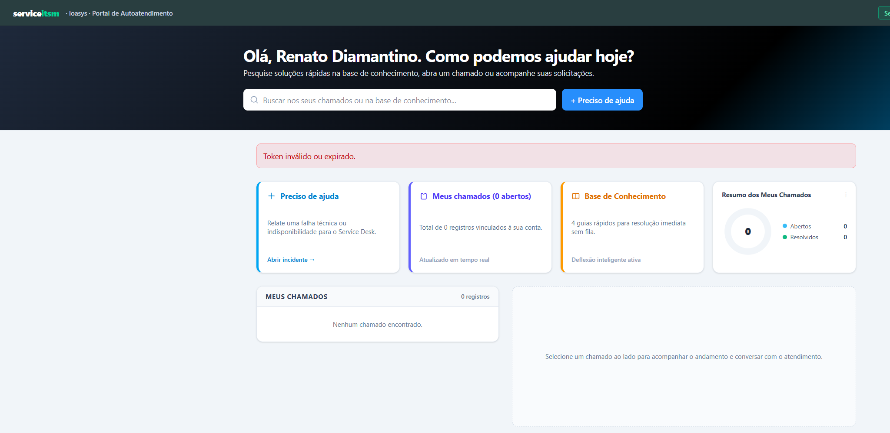
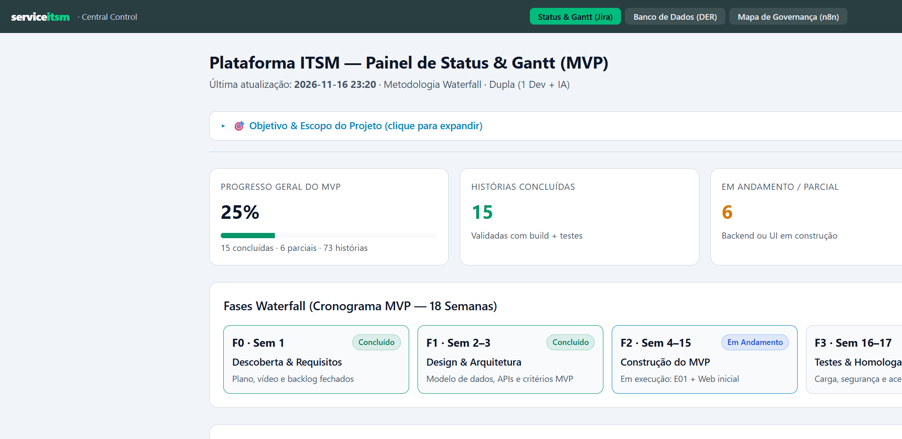

# Desafio Técnico ioasys — Plataforma ITSM

> Plataforma completa de **Gestão de Serviços de TI (ITSM)** dedicada (*single-tenant*), inspirada no **ServiceNow ITSM**, construída com **TypeScript ponta a ponta**, metodologia **Waterfall assistida por IA** e governança contínua via **Rules, Memória Persistente, QA Gate e Painéis Visuais Vivos**.

---

## 1. Visão do Produto & Metas do Desafio

A plataforma centraliza todas as solicitações e falhas de TI em um único lugar, oferecendo:
- **Portal de Autoatendimento (`/portal`)** para o usuário final abrir, acompanhar, comentar e reabrir chamados com deflexão por Base de Conhecimento;
- **Service Operations Workspace (`/workspace`)** para agentes N1/N2/N3 e gestores, com indicadores *Donut*, *Ações Importantes*, filtros e painel Master-Detail;
- **Motor No-Code** (planejado no MVP) e **IA para triagem/assistência** nas releases futuras.

### Objetivos Mensuráveis (Produto Completo — `Plan/plano_itsm.md`)
- Reduzir o tempo médio de resolução (**MTTR**) em **30%**;
- Atingir **≥ 25% de deflexão** via Portal / Base de Conhecimento / Chatbot;
- Alcançar **≥ 80% de acerto** na classificação automática;
- Manter cumprimento de **SLA ≥ 95%**.

---

## 2. Prints da Aplicação em Funcionamento

### Service Operations Workspace (`/workspace`)


### Portal de Autoatendimento (`/portal`)


### Central Control (`/control`) — Status & Gantt (Jira)


### Central Control (`/control`) — DER PostgreSQL (Visual Paradigm)


### Central Control (`/control`) — Mapa de Governança (n8n)


---

## 3. Stack Tecnológica & Justificativas (`documentação.md`)

| Camada | Tecnologias | Por que foi escolhida |
|---|---|---|
| **Monorepo & Linguagem** | Node.js `>= 22`, TypeScript `^5.7`, `pnpm` `11.1.2`, Zod `^3.24` | Tipagem e contratos de validação compartilhados (`@itsm/shared`) entre API e Web sem duplicação |
| **Backend (`apps/api`)** | NestJS `^11`, Express, Prisma ORM `^6.3`, Swagger/OpenAPI | Arquitetura modular por domínio ITSM, injeção de dependência, guards RBAC e migrações tipadas |
| **Segurança & Auth** | Argon2id (`argon2`), JWT (`@nestjs/jwt`), MFA TOTP (`otplib` `^13.6`) | Hash resistente, sessões stateless (`access`/`refresh`), bloqueio `429` e 2FA padrão de mercado |
| **Frontend (`apps/web`)** | Next.js `^15.2` (App Router), React `^19`, Tailwind CSS `^4` | Base única para `/workspace`, `/portal`, `/control` e rotas administrativas com Light/Dark Mode |
| **Infraestrutura** | Docker Compose, PostgreSQL `16-alpine`, Redis `7-alpine`, MinIO | Relacional + `JSONB` (no-code), suporte a filas/timers (BullMQ) e anexos S3-compatíveis |

---

## 4. Estrutura do Repositório

```text
servicenow/
├── packages/shared/       # Schemas Zod, matriz Impacto × Urgência, i18n (pt-BR/en/es)
├── apps/api/              # API REST NestJS + Prisma Schema/Migrations + Seed + Testes
├── apps/web/              # Frontend Next.js (Design System ServiceNow + Central Control)
├── Plan/                  # Especificação Waterfall (F0/F1)
│   ├── plano_itsm.md              # Visão, 11 personas, 27 épicos (~165 US), cronograma 18 sem
│   ├── modelo_dados_e_apis.md     # Modelo unificado TASK, índices e contratos REST/WS
│   └── criterios_aceite_mvp.md    # Critérios Dado/Quando/Então das 71 histórias do MVP
├── Control/               # Painéis Visuais Vivos (também acessíveis em /control)
│   ├── status.html                # Painel estilo Jira/Scrum + Gantt das 71 US + Pós-MVP
│   ├── banco.html                 # DER PostgreSQL interativo estilo Visual Paradigm
│   └── mapping.html               # Mapa animado estilo n8n (Rules → IA → QA Gate → Docs)
├── Soul/                  # Governança & Memória Contínua do Agente
│   ├── AGENTS.md                  # Regras obrigatórias (herança TASK, BigInt, UI/UX, QA Gate)
│   ├── skills.md                  # Persona Full-Stack + UI/UX Sênior + Definition of Done
│   └── memory.md                  # Memória persistente (RAG) com decisões e armadilhas resolvidas
├── .agents/rules/         # Rule always_on conectando o Antigravity ao Soul/AGENTS.md
├── documentação.md        # Registro técnico vivo do que foi implementado e validado
└── docker-compose.yml     # PostgreSQL 16, Redis 7 e MinIO
```

---

## 5. Planejamento Waterfall & Escopo (`Plan/`)

O produto completo foi especificado em **27 épicos (`E01`–`E27`, ~165 histórias)** em [Plan/plano_itsm.md](Plan/plano_itsm.md), divididos em:
- **MVP (14 épicos / 71 histórias — 18 semanas, Fases F0 a F4):**
  - `E01` Plataforma Base · `E02` Gestão de Incidentes · `E03` Workspace do Agente · `E04` SLA/OLA · `E05` Notificações/E-mail · `E06` Portal Autoatendimento · `E07` Catálogo/Requisições · `E08` Base de Conhecimento · `E12` CMDB Mínima · `E13` Workflow No-Code · `E14` Relatórios/Dashboards · `E24` CSAT · `E26` API/Webhooks · `E27` Admin/No-Code.
- **Pós-MVP (13 épicos — Releases R2, R3 e R4):**
  - `E09` Problemas · `E10` Mudanças · `E11` Releases · `E15` Performance Analytics · `E16` Incidentes Graves (MIM) · `E17` ML · `E18` IA Generativa · `E19` Agente Virtual · `E20` Walk-up · `E21` DevOps · `E22` Melhoria Contínua · `E23` Força de Trabalho · `E25` Mobile.

Todos os critérios testáveis das 71 histórias do MVP estão documentados em [Plan/criterios_aceite_mvp.md](Plan/criterios_aceite_mvp.md) e o modelo de dados completo em [Plan/modelo_dados_e_apis.md](Plan/modelo_dados_e_apis.md).

---

## 6. Painéis Visuais & Central Control (`Control/` e `/control`)

Os arquivos em `Control/` podem ser abertos diretamente no navegador ou via **`http://localhost:3000/control`** com a aplicação rodando:

- **`Control/status.html` (Painel Jira & Gantt):**
  - KPIs de progresso do MVP, Fases Waterfall (`F0`–`F4`), Gantt das 71 histórias MVP e tabela de histórias Pós-MVP (`R2`–`R4`).
  - Modal interativo estilo **Jira/Scrum** ao clicar em qualquer Épico ou História (`US-xxx`), exibindo objetivo, filhos, critérios de aceite e evidências.
- **`Control/banco.html` (DER PostgreSQL — Estilo Visual Paradigm):**
  - Diagrama interativo das **13 tabelas** implementadas em `apps/api/prisma/schema.prisma`, com `PK`, `FK`, `UK`, tipos PostgreSQL, cardinalidades (`1:1`, `N:1`), arraste de entidades, zoom/pan e inspetor de vínculos.
- **`Control/mapping.html` (Mapa de Governança — Estilo n8n):**
  - Fluxo visual animado com bolinhas direcionais mostrando `INPUT` e `OUTPUT` entre `Pedido do Usuário`, `Rules Always-On`, `Agente IA`, `QA Gate`, loop de correção e atualização da documentação viva.

---

## 7. Governança Contínua & QA Gate (`Soul/` e `.agents/rules/`)

Para evitar perda de contexto entre sessões ou trocas de modelo de IA:
- **[.agents/rules/itsm-workflow.md](.agents/rules/itsm-workflow.md)** é carregada automaticamente em todo turno (`trigger: always_on`) e aponta para **[Soul/AGENTS.md](Soul/AGENTS.md)**.
- **[Soul/skills.md](Soul/skills.md)** define a persona multidisciplinar (*Arquiteto + Engenheiro Full-Stack + Designer UI/UX Sênior + QA*) e o **QA Gate obrigatório** (build, `tsc --noEmit`, testes unitários, validação de serialização `BigInt` e `403` RBAC, conferência de UI).
- **[Soul/memory.md](Soul/memory.md)** guarda decisões fechadas, armadilhas resolvidas (como `otplib` v13 e `AuditLog.id` em `BigInt`) e o ponto exato de parada.

---

## 8. O que já foi Implementado & Validado (`documentação.md`)

### Backend (`apps/api` — 26/26 testes unitários passando)
- **Organização (`US-001`):** `GET /api/v1/organization`, `POST /api/v1/organization/setup`, `PATCH /api/v1/organization`.
- **Auth, MFA & RBAC (`US-002`, `US-005`):** `POST /api/v1/auth/login` (bloqueio 15min após 5 falhas → HTTP `429`), `POST /api/v1/auth/mfa/setup|verify`, `POST /api/v1/auth/refresh`, `GET /api/v1/auth/me`, `PUT /api/v1/auth/users/:id/roles`, `JwtAuthGuard` + `RolesGuard`.
- **SSO Corporativo (`US-003`):** `GET /api/v1/auth/sso/config`, `GET|PUT /api/v1/auth/sso/admin-config`, `GET /api/v1/auth/sso/login`, `POST /api/v1/auth/sso/callback` (OIDC/SAML + *Just-In-Time provisioning*).
- **Importação CSV & SCIM 2.0 (`US-004`):** `POST /api/v1/users/import/csv` (validação + `dryRun`) e `/api/v1/scim/v2/Users` (`GET`, `POST`, `PUT`, `PATCH`, `DELETE`) com `ScimTokenGuard`.
- **Auditoria Imutável (`US-006`):** `GET /api/v1/audit-logs` e `GET /api/v1/audit-logs/entity/:entityType/:entityId` (somente leitura, `BigInt` serializado para `string`).
- **i18n (`US-008`):** `PATCH /api/v1/auth/me/locale` + dicionário completo `pt-BR` / `en` / `es`.
- **Incidentes (`E02` núcleo + `US-082`):** `GET /api/v1/incidents`, `GET /api/v1/incidents/my`, `POST /api/v1/incidents`, `GET /api/v1/incidents/:id`, `PATCH /api/v1/incidents/:id`, `POST /api/v1/incidents/:id/comments`, `POST /api/v1/incidents/:id/resolve`, `POST /api/v1/incidents/:id/reopen`, `POST /api/v1/incidents/:id/link-children`.

### Frontend (`apps/web` — Design System ServiceNow + Light/Dark Mode)
- **Shell Corporativo (`AppShell`):** Barra global `#293e40`, menu lateral `#303a46` com **Filtrar menu**, abas funcionais **Apps / ★ Favoritos / ◷ Histórico** (`localStorage`), menu de perfil com idioma e Sair, e ícone Sol/Lua.
- **Rotas:** `/setup`, `/login`, `/workspace` (*Ações Importantes*, 4 gráficos **Donut**, lista estilo ServiceNow e Master-Detail), `/workspace/audit`, `/workspace/users/import`, `/workspace/settings/sso`, `/portal` (Portal de Autoatendimento com deflexão e Donut) e `/control`.

---

## 9. Como Rodar Localmente

```powershell
# 1. Instalar dependências
pnpm install

# 2. Subir PostgreSQL 16, Redis 7 e MinIO
docker compose up -d

# 3. Gerar Prisma Client, aplicar migrações e popular dados demo
pnpm db:generate
pnpm db:migrate
pnpm db:seed

# 4. Iniciar API (3001) e Web (3000)
pnpm dev
```

### Acessos & Credenciais Demo (`pnpm db:seed`)
- **Web App:** `http://localhost:3000`
- **Central Control:** `http://localhost:3000/control`
- **Swagger / OpenAPI:** `http://localhost:3001/api/docs`
- **Usuários demo (senha `Itsm@2026`):** `ana.n1@itsm.local` (`agent`), `carlos.infra@itsm.local` (`agent`), `mariana.gestora@itsm.local` (`manager`), `joao.usuario@itsm.local` (`end_user`).

---

## 10. Testes & Qualidade

```powershell
pnpm build                      # Build completo (@itsm/shared, @itsm/api, @itsm/web)
pnpm --filter @itsm/api test    # 26/26 testes unitários em 6 suítes
pnpm --filter @itsm/web lint    # Type-check Next.js (tsc --noEmit)
```
